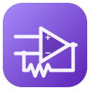
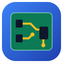
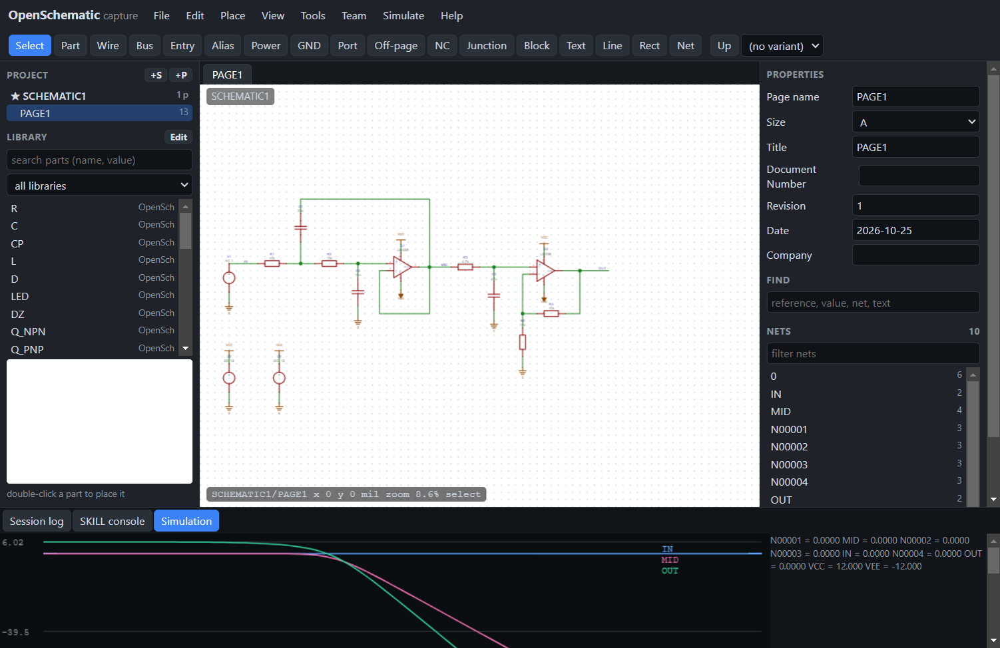
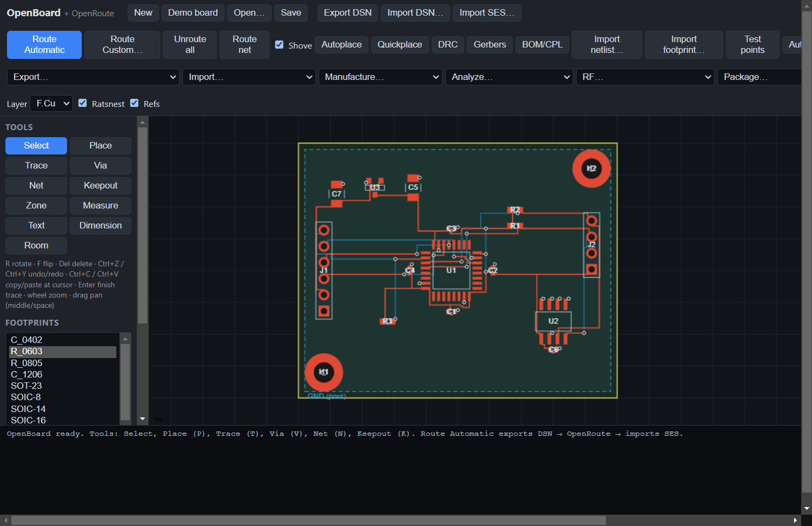

<p align="center">
  <picture>
    <source media="(prefers-color-scheme: dark)" srcset="assets/logo-dark.svg">
    
  </picture>
</p>

<p align="center">
  <b>Open-source PCB design suite: schematic capture, board layout and a shape-based autorouter.</b><br>
  A Windows desktop app, plus a command line for scripts and AI agents.
</p>

<p align="center">
  <a href="https://github.com/ajisrawi/openpcb/releases/latest"></a>
</p>

<p align="center">
  <a href="https://github.com/ajisrawi/openpcb/releases/latest"></a>
  
  
</p>

---

## The programs

<table>
<tr>
<td width="33%" align="center" valign="top">
<br>
<h3>OpenSchematic</h3>
Schematic capture: hierarchy, symbol editor, ERC, annotation, BOM, PDF, variants, SPICE simulation, constraint manager and team design.<br>
Opens <b>OrCAD Capture</b> (.DSN/.OLB), <b>System Capture</b> (.sdax), <b>Design Entry HDL</b>, <b>KiCad</b> and <b>Altium</b> schematics.<br><br>
<i>Window → OpenSchematic</i> (Ctrl+2)
</td>
<td width="33%" align="center" valign="top">
<br>
<h3>OpenBoard</h3>
PCB layout editor: footprints, traces and vias, copper pours, full DRC, 3D view, autoplace, Gerber/drill, BOM and pick-and-place, STEP/IDF/IDX for MCAD.<br>
Imports KiCad, Eagle, Altium, PADS and SPECCTRA designs.<br><br>
<i>Window → OpenBoard</i> (Ctrl+1)
</td>
<td width="33%" align="center" valign="top">
<br>
<h3>OpenRoute</h3>
Shape-based autorouter: SPECCTRA <code>.dsn</code> in, <code>.ses</code> out, do-file scripts, fanout, rip-up and reroute, blind/buried/micro vias, differential pairs, length tuning, gridless finishing.<br><br>
Built into OpenBoard (<i>Route Automatic</i>) and the <code>openroute</code> CLI.
</td>
</tr>
</table>

Everything runs locally on your machine. Nothing is uploaded.

<p align="center"> </p>

## Download

Download **`OpenBoard-<version>-portable.exe`** from the [latest release](https://github.com/ajisrawi/openpcb/releases/latest) and run it; there is nothing to install. The app has two windows, OpenBoard and OpenSchematic (*Window* menu, Ctrl+1 / Ctrl+2), native file dialogs and cross-probing. The `openpcb` command line ships inside it and needs no separate Node.js.

## Build from source

Requires Node.js 20 or newer.

```bash
git clone https://github.com/ajisrawi/openpcb.git
cd openpcb
npm install
npm run build
npm run desktop:start    # run the desktop app from source
npm run desktop          # build the portable .exe into packages/desktop/release/
npm run schematic        # or use it in a browser: http://localhost:5174 (OpenBoard) and /schematic/ (OpenSchematic)
```

## Command line

`openpcb` builds, routes, checks and exports boards and schematics with JSON output, so scripts and AI agents can drive the whole flow without a GUI:

```bash
npm run openpcb -- new board.openboard.json --layers 2 --width 80 --height 60
npm run openpcb -- add board.openboard.json SOIC-8 U1 20 15 --value MCU
npm run openpcb -- net board.openboard.json VCC U1-8 J1-1
npm run openpcb -- route board.openboard.json
npm run openpcb -- drc board.openboard.json             # exit code 2 when violations exist
npm run openpcb -- gerber board.openboard.json out/

npm run openpcb -- sch-import-orcad design.dsn design.sch.json
npm run openpcb -- sch-erc design.sch.json
npm run openpcb -- sch-to-board design.sch.json board.openboard.json
```

The router alone, SPECCTRA style:

```bash
npm run route -- examples/demo.dsn -do examples/route.do
```

`openpcb help` lists every command.

## What's inside

| Area | Highlights |
|---|---|
| **Schematic** | Multi-page hierarchy, reusable blocks, buses, off-page connectors, symbol editor, ERC with editable pin matrix, annotation, find/replace, variants, part database (CSV) link, design compare, constraint manager, team design server with page reservations, OpenSKILL console |
| **Simulation** | Built-in SPICE: bias point, transient and AC analysis with plots |
| **Layout** | Parametric footprints and library import, interactive routing, copper pours with thermals, rigid-flex, wire bonding, autoplace, panelization, back-annotation |
| **Routing** | Multi-pass rip-up and reroute, gridless shape router, via spans (blind, buried, stacked microvias), differential pairs, length matching, miter/smooth |
| **Checks and analysis** | Full DRC (clearance, annular ring, hole rules, silk, mask, pairs, lengths), pour connectivity check, impedance from the stack-up with a field solver, IR drop, thermal, EMI checks |
| **Outputs** | Gerber RS-274X X2, Excellon drill, BOM, pick-and-place, PDF, SVG, STEP, IDF, IDX, netlists (KiCad, Telesis, EDIF, SPICE) |
| **Imports** | OrCAD Capture, System Capture, Design Entry HDL, KiCad, Altium, Eagle, PADS, Gerber, SPECCTRA DSN/SES |

The schematic importers are checked against the netlists the original tools wrote: on the OrCAD sample designs all 1,645 multi-pin page nets agree, and all 11 System Capture sample archives match their stored connectivity.

Full documentation: **[docs/REFERENCE.md](docs/REFERENCE.md)**.

## Repository layout

```
packages/router      OpenRoute: autorouter library and CLI
packages/editor      OpenBoard: browser PCB editor
packages/schematic   OpenSchematic: browser schematic editor and importers
packages/cli         openpcb command line and tests
packages/desktop     Windows desktop app (Electron)
examples             sample boards, do-files and scripts
assets               logo and icons
```

## Tests

```bash
npm test -w @openpcb/router      # router unit tests
npm test -w @openpcb/cli         # board, schematic and integration tests
```

Some import tests compare against vendor sample files and are skipped when those are not installed (set `CADENCE_HOME` to an SPB install to run them).

---

<sub>OrCAD, Allegro and SPECCTRA are trademarks of Cadence Design Systems; KiCad, Altium, Eagle and PADS belong to their respective owners. openpcb is an independent project and is not affiliated with or endorsed by any of them.</sub>
